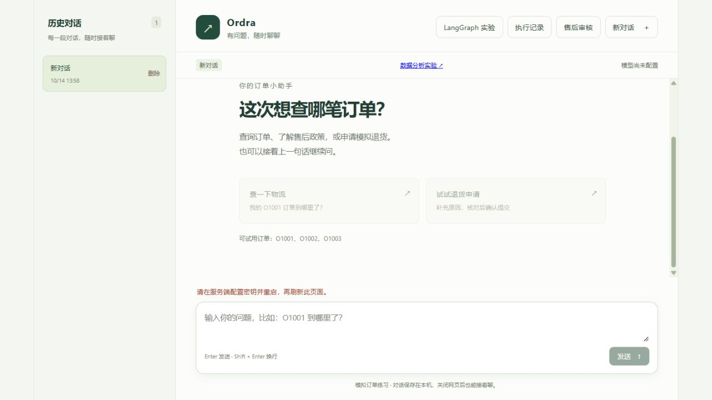

# Ordra · 订单客服 Agent

Ordra 是基于 **Python、FastAPI、LangGraph 和 MCP** 的订单客服应用，提供订单查询、政策检索、退货申请处理和多轮对话。执行过程包含工具调用、人工审批、结果校验与检查点恢复，可在网页中查看每次任务的证据和状态。

当前订单、业务政策和分析 CSV 均为模拟数据。退货流程创建本地模拟申请，尚未接入真实订单系统或支付退款接口。

## 功能

- **订单与政策查询**：通过本地 MCP 服务查询订单、检索知识库，并在回答中保留实际检索来源。
- **审批与恢复**：退货预览支持批准、修改参数或拒绝；SQLite 保存会话、人工决定与执行检查点。
- **上下文管理**：结合 token 预算、滚动摘要、当前任务压缩与会话原文检索，保留完整持久化历史。
- **按需加载与委派**：按任务发现工具、加载 Skills 指引及引用资料；订单和知识子 Agent 使用独立上下文并共享执行预算。
- **执行记录**：查看工具证据、计划、审批、失败恢复、模型请求数及已报告的 token 用量。
- **订单数据分析**：为模拟订单 CSV 生成 Python 子集代码，在 Monty 独立工作进程中执行；宿主重算并核对结果后，提供 Markdown 和 CSV 报告。

## 架构

~~~mermaid
flowchart TD
    UI["网页 · fetch / SSE"] --> API["FastAPI · 会话与任务接口"]
    API --> G["LangGraph 主聊天图"]
    G --> C["上下文与计划"]
    G --> M["模型决策"]
    M --> D["工具发现 / Skills / 子 Agent"]
    D --> T["工具运行时 · 预算 / 并发 / 重试"]
    T --> MCP["本地 MCP stdio 服务"]
    MCP --> O["模拟订单"]
    MCP --> K["示例知识库"]
    T --> A["人工审批 → 退货预览"]
    A --> CONF["用户确认 → 本地模拟申请"]
    G --> V["答复与证据校验"]
    G <--> DB[("SQLite · 会话 / 检查点 / 轨迹")]
    V --> UI
~~~

主聊天使用 LangGraph 编排上下文、模型决策、工具、委派、审批和校验节点。MCP 服务通过标准输入输出提供只读订单查询与知识检索，由应用管理进程生命周期，无需单独启动或配置额外服务端口。

## 快速开始

建议使用 **Python 3.12+**；当前验证环境为 **Python 3.14**。直接依赖版本固定在 `requirements.txt`，前端使用原生 HTML/CSS/JavaScript，无需 Node.js 构建。

在 PowerShell 中克隆仓库、创建虚拟环境并安装依赖：

~~~powershell
git clone https://github.com/gdmec07150725/ordra.git
cd ordra
python --version
python -m venv .venv
.\.venv\Scripts\python.exe -m pip install -r requirements.txt
Copy-Item .env.example .env
~~~

编辑 `.env`，填写自己的 `DEEPSEEK_API_KEY`，将 `DEEPSEEK_MODEL` 替换为账号可用的模型名称，然后启动服务：

~~~powershell
.\.venv\Scripts\python.exe -X utf8 07_api_server.py
~~~

打开 [Ordra](http://127.0.0.1:8000)。服务默认以单进程监听 `127.0.0.1:8000`，首次启动自动创建 `data/` 中的 SQLite 数据库；[健康检查](http://127.0.0.1:8000/api/health)和[接口文档](http://127.0.0.1:8000/docs)可用于确认运行状态。

macOS / Linux 将解释器路径替换为 `.venv/bin/python`，复制配置使用 `cp .env.example .env`。没有模型密钥时，仍可运行离线测试、场景评测与 `02_query_order.py O1001`。

## 配置

环境变量优先于 `.env`；修改配置后重启服务。`.env.example` 包含占位字段和可运行的检索、预算设置，真实密钥应仅保存在自己的环境中。

| 变量 | 说明 |
| --- | --- |
| `DEEPSEEK_API_KEY` | 模型服务密钥；离线评测不需要 |
| `DEEPSEEK_MODEL` | 账号可用的模型名称；应用通过 DeepSeek 兼容 API 调用 |
| `AGENT_TOOL_MODE` | `mcp` 为默认模式；`local` 使用本地直接调用路径 |
| `AGENT_HISTORY_SEARCH` | 示例为 `keywords`；`hybrid` 启用关键词与本地向量混合检索 |
| `AGENT_CONTEXT_TOKENS` | 总上下文预算，示例为 `32768` |
| `AGENT_RECENT_TOKENS` | 近期完整历史目标预算，示例为 `2048` |
| `AGENT_SUMMARY_TOKENS` | 滚动摘要预算，示例为 `512` |

关键词检索无需下载向量模型。使用混合检索时，先运行以下命令，再将 `AGENT_HISTORY_SEARCH` 改为 `hybrid` 并重启：

~~~powershell
.\.venv\Scripts\python.exe -X utf8 local_embeddings.py
~~~

模型文件保存在 `.local/embeddings/`。服务只读取本地模型，缺失或不可用时回退到关键词检索。知识库位于 `knowledge/`，技能位于 `skills/`；选中的知识片段和技能内容会进入聊天模型上下文。

## 关键工作流

**查询订单与政策。** 在聊天页输入“查询 O1003 的状态和退货政策”。Agent 按需发现查询工具，获取订单事实和政策原文，完成结果校验后回复；来源卡片可查看检索依据。

**处理退货申请。** 输入“O1003 的耳机左侧没有声音，请帮我准备退货申请”。页面先展示待审批参数，可批准、修改后批准或拒绝。批准后生成预览，再由用户确认创建模拟申请；[售后审核](http://127.0.0.1:8000/returns)支持人工审核。审批、提交和审核均不代表真实退款已完成。

**恢复中断任务。** 刷新页面或重启服务后，可从未完成任务的检查点继续，复用已保存的工具结果。恢复沿用原任务预算；尚未保存的只读工作可能重做，也可放弃任务后重新提问。

**分析订单数据。** 在[数据分析](http://127.0.0.1:8000/code)中选择模拟 CSV 和统计目标，查看生成代码、执行反馈及核对结果。只有通过宿主独立校验的任务才提供报告下载；服务重启后的未完成分析需要重新运行。

[执行记录](http://127.0.0.1:8000/runs)展示任务轨迹与上下文预算；[LangGraph 流程对照](http://127.0.0.1:8000/graph)提供独立的单问题执行入口。

## 开发与测试

在仓库根目录运行：

~~~powershell
.\.venv\Scripts\python.exe -X utf8 -m unittest discover -s tests -v
.\.venv\Scripts\python.exe -X utf8 agent_eval.py --suite all
.\.venv\Scripts\python.exe -X utf8 mcp_eval.py
.\.venv\Scripts\python.exe -X utf8 langgraph_eval.py
.\.venv\Scripts\python.exe -X utf8 code_eval.py
~~~

上述命令使用脚本模型或模拟传输替代外部模型 API；业务工具、临时 SQLite 数据库及对应的 MCP 服务、代码沙箱实际运行。`agent_eval.py --suite all` 覆盖单轮、多轮和 Skills 场景；其他入口分别比较 MCP、LangGraph 流程并验证代码分析。

场景评测在 `.local/evals/` 生成 JSON 和 HTML 报告，失败时返回非零退出码。需要比较主管直查与子任务委派策略时，可运行 `decision_eval.py`。

场景评测只有显式加入 `--live` 才调用配置模型并产生用量。离线结果验证执行流程与规则约束，不代表真实模型准确率、生产可用率或成本收益。

## 目录与技术文档

| 路径 | 职责 |
| --- | --- |
| `web/`、`api_app.py` | 网页、HTTP/SSE 接口及会话管理 |
| `full_agent_graph.py`、`agent_service.py` | 主聊天图、Agent 公共入口与工具适配 |
| `mcp_tool_client.py`、`mcp_tool_server.py` | MCP 连接、工具定义发现与调用 |
| `human_approval.py`、`checkpoint_store.py` | 人工决定、会话归属校验与恢复 |
| `knowledge/`、`skills/`、`examples/` | 政策资料、处理指引与模拟数据 |
| `tests/`、`*_eval.py` | 回归测试与场景评测 |
| `data/`、`.local/` | 本地运行数据、模型和报告，不纳入版本管理 |

按模块阅读：

- [HTTP 与流式接口](docs/06_FastAPI接口与网页聊天.md)、[SQLite 持久化](docs/07_SQLite会话持久化.md)
- [上下文管理](docs/08_上下文管理.md)、[会话原文检索](docs/09_历史检索工具.md)、[知识库检索](docs/10_业务知识库RAG使用.md)
- [子 Agent 委派](docs/11_子Agent接入与任务委派.md)、[MCP 与工具发现](docs/12_MCP接入与工具按需发现.md)
- [Skills 按需加载](docs/13_Skills接入与按需加载.md)、[代码执行与沙箱](docs/14_代码执行Agent与沙箱隔离.md)
- [执行策略评测](docs/Agent执行策略实验.md)

## 当前限制

- 默认面向本地单进程运行，没有用户登录、真实订单权限校验或公网多租户部署能力。
- 订单、政策和 CSV 均为模拟资料；退货申请仅保存到本地 SQLite，未接入真实业务系统或支付接口。
- 结果校验结合模型判断与程序约束，仍可能遗漏语义错误；重要业务结论需要人工核对。
- 工具按需发现可能增加模型请求，小工具目录不保证降低总 token 用量或耗时。
- MCP 目前只连接固定的本地只读服务；Skills 不执行脚本，也不增加工具权限。
- Monty 支持 Python 子集，不提供任意依赖安装或通用容器环境；代码分析的恢复机制与主聊天检查点不同。

## 许可证

[MIT](LICENSE) · Copyright 2026 Liao Nan
