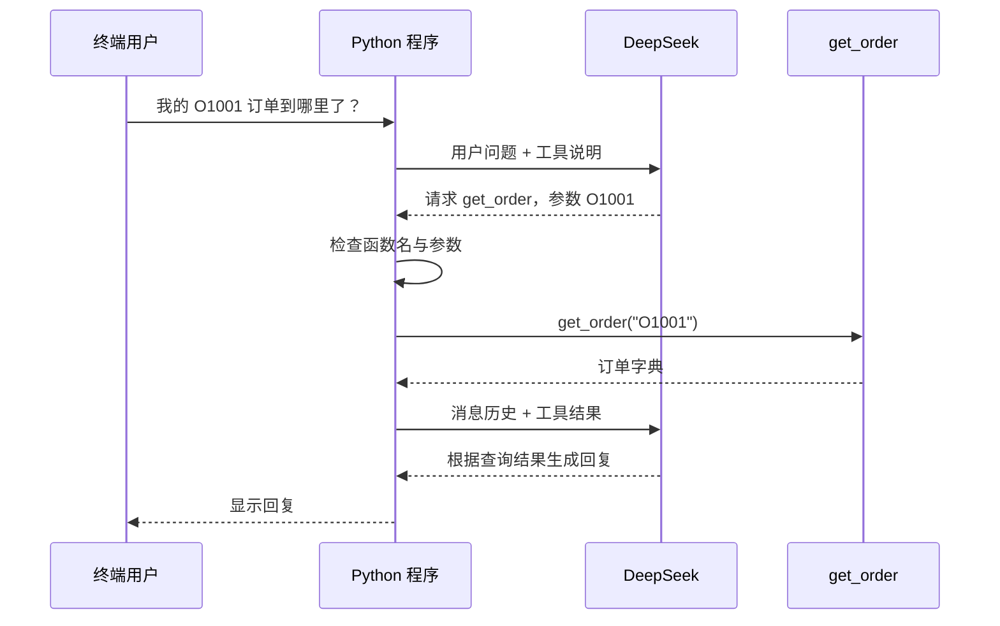

# 第三课：让模型通过工具查询订单

> 本文按课程阶段讲解；请在仓库根目录执行命令。安装与当前功能以[仓库 README](../README.md)为准，早期章节中的简化流程不代表最终实现。

本课把前两课连接起来：模型负责理解问题、提出查询请求和组织回复；Python 负责检查参数、执行 `get_order()`，并把结果送回模型。

主文件：`.\04_order_agent.py`。运行前按仓库 README 安装依赖并配置 `.env`；本课复用 DeepSeek 客户端与 `orders.py`。

## 1. 先运行一遍

```powershell
# 在仓库根目录运行
.\.venv\Scripts\python.exe -X utf8 .\04_order_agent.py '我的 O1001 订单到哪里了？'
```

不传问题时，也会默认查询这个问题。终端会依次显示模型请求次数、模型提出的工具调用、Python 查询结果，以及最终回复。

观察重点是：先出现 `get_order` 工具请求与查询结果，再出现基于该结果的回复。具体措辞、请求次数和 token 用量由实际运行决定。

## 2. 为什么需要再请求一次模型

第一轮发送用户问题和工具说明后，模型会决定是否查询订单。如果决定查询，它会返回函数名和参数。程序得到真实查询结果后，第二轮把这份结果提供给模型，模型才能据此组织回答。



工具调用协议中的关键分工是：模型提出调用请求，应用程序执行函数并回传结果。DeepSeek 的 [Tool Calls 官方指南](https://api-docs.deepseek.com/zh-cn/guides/tool_calls/) 也使用这一流程。

实际运行不一定恰好两轮：普通问候可以直接回复；多个查询或参数修正可能需要更多轮。本例最多请求模型 4 次，达到上限仍要求工具时就停止。

## 3. 推荐阅读顺序

| 顺序 | 代码位置 | 先回答一个问题 |
|---|---|---|
| 1 | `TOOLS` | 模型怎样知道有哪些工具、参数是什么？ |
| 2 | `run_agent()` | 模型结果回来后，程序怎样决定下一步？ |
| 3 | `execute_tool()` | 函数究竟在哪里被执行？ |
| 4 | `main()` | 密钥、问题和 client 怎样传入主流程？ |

`main()` 大部分内容沿用第二课：读取配置、创建 `client`、处理异常。学习重点是前三处新增内容。为方便单独运行和对照学习，本课保留这段初始化代码。

## 4. 工具说明与工具函数的区别

`TOOLS` 中的一项是给模型看的说明：

```python
# 摘出重点字段：实际代码还包含参数类型、描述和必填要求。
tool_description = {
    "name": "get_order",
    "description": "根据用户提供的订单号查询模拟订单状态、物流和商品信息。缺少订单号时先询问用户。",
}
```

它描述“可以做什么”和“调用时应该提供什么”。实际函数则由 Python 导入：

```python
from orders import get_order
```

两者通过 `execute_tool()` 连接：

```python
# 模型返回的工具名必须是我们允许的工具。
if tool_name != "get_order":
    return {"error": f"不支持工具 {tool_name}，当前仅可使用 get_order。"}

# 将 JSON 参数解析成 Python 数据。
arguments = json.loads(arguments_json)

# 完成参数检查后，执行本地函数。
return get_order(arguments["order_id"])
```

这里展示的是核心步骤；实际函数还检查 JSON 格式、参数对象结构、额外字段和订单号类型。`TOOLS` 没有上传函数源码或整个订单字典，只有执行完成后，相应的查询结果才会放入消息。

## 5. 理解 messages 如何变化

第一次请求时，消息是：

```text
system：你是一位中文订单客服助手……
user：我的 O1001 订单到哪里了？
```

模型提出工具调用后，程序先保存这条 `assistant` 消息，再追加本机执行得到的 `tool` 消息。第二次请求时变成：

```text
system：你是一位中文订单客服助手……
user：我的 O1001 订单到哪里了？
assistant：请求 get_order({"order_id": "O1001"})，调用 ID 为 call-xxx
tool：对应 call-xxx，返回订单状态和物流信息
```

代码里最重要的一次追加是：

```python
messages.append({
    "role": "tool",                  # 表示这条消息来自工具执行结果。
    "tool_call_id": tool_call.id,    # 指明它回答的是哪一个调用请求。
    "content": result_json,         # 将查询结果编码成 JSON 文本。
})
```

一次响应可能请求查询 O1001 和 O1002。每个请求都有各自的 ID，程序必须给每个调用追加对应结果，然后再请求模型。本课使用普通 `for` 循环依次执行它们。

`print(result_json)` 只会把内容显示在终端；`messages.append(...)` 才会让下一次模型请求携带查询结果。这与第一课的“return 和 print 有什么区别”直接相关。

## 6. 新出现的 Python 写法

| 写法 | 含义 |
|---|---|
| `json.loads(arguments_json)` | 将模型给出的 JSON 文本解析成 Python 数据 |
| `json.dumps(result, ensure_ascii=False, indent=2)` | 将工具返回字典转换为可读的 JSON 文本 |
| `messages.append(...)` | 在列表末尾增加一条消息，类似数组的 push |
| `for ... in range(1, 5)` | 依次处理 1、2、3、4 四轮 |
| `continue` | 结束当前这一轮，进入下一轮循环 |
| `return 0` | 结束当前函数，向调用者报告成功 |
| `call.model_dump(exclude_none=True)` | 将 SDK 对象变成字典，省略值为 None 的字段 |

代码中的 `[call.model_dump(...) for call in message.tool_calls]` 是列表推导式：遍历调用列表，将每一项转换成字典，收集成一个新列表。可以类比 TypeScript 的 `toolCalls.map(call => ...)`。

## 7. 可以自己验证的场景

```powershell
# 查询你在第一课练习中新增的订单。
.\.venv\Scripts\python.exe -X utf8 .\04_order_agent.py '查一下 O1003 的状态'

# 不存在的订单：观察工具中的 error 如何交给模型。
.\.venv\Scripts\python.exe -X utf8 .\04_order_agent.py '帮我查 O9999'

# 缺少订单号：期望模型先询问订单号。
.\.venv\Scripts\python.exe -X utf8 .\04_order_agent.py '我的订单到哪里了？'

# 一次查询两个订单：观察模型是否一次返回多个调用。
.\.venv\Scripts\python.exe -X utf8 .\04_order_agent.py '帮我查 O1001 和 O1002'
```

先观察“模型请求工具”和“工具结果”两段，再看最终话术。当前每次启动处理一个用户问题，进程结束后不保存历史。如果模型让你补订单号，请重新运行并给出完整问题，例如“查 O1001”；连续输入和多轮会话将在后续学习。

提示词要求模型依据工具回答，但这仍是需要评估的模型行为；本课的程序检查负责限制实际执行的工具和参数。当前工具读取本地模拟数据，真实客服的账号身份与订单访问权限属于后续服务化内容。

## 8. 本课完成到什么程度

已完成：工具描述、模型提出调用、参数检查、本地执行、工具结果回传、继续请求、最终回复、调用轮数限制，以及服务端具体错误显示。

离线测试覆盖正常查询、多个调用结果配对、直接回复、未知工具、6 种错误参数、订单不存在、循环上限、截断工具调用和 API 错误。测试使用模拟 HTTP 响应，实际执行 SDK 消息组装与本机订单函数。

```powershell
.\.venv\Scripts\python.exe -X utf8 -m unittest discover -s tests -v
```

先做到能指出“函数真正执行的那一行”和“结果发回模型的那几行”，再尝试为订单数据增加字段并观察变化。理解这些之后，继续 [第四课：多轮对话与会话历史](04_多轮对话与会话历史.md)，让“查一下我的订单”→“订单号 O1001”在同一次会话内完成。
