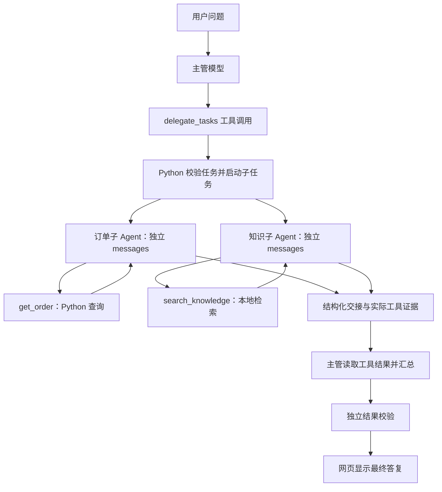

**第十一课：子 Agent 的接入与任务委派**

> 本文按课程阶段讲解；请在仓库根目录执行命令。安装与当前功能以[仓库 README](../README.md)为准，早期章节中的简化流程不代表最终实现。

这份教程对应 `.` 当前实现。先在网页观察一次协作，再沿实际代码理解“主管怎样叫来子 Agent、子 Agent 怎样工作、结果怎样交回来”。文中的示意数据用于说明协议，真实调用 ID、检索结果和回答措辞会变化。

**1. 当前接入方式是什么**

项目使用“工具式委派”：主管模型拥有一个 `delegate_tasks` 工具，调用它时，Python 程序启动子 Agent 的模型调用循环，最后把结果作为工具消息返回主管。

当前主管和子 Agent 共用配置好的聊天模型及客户端，在同一个 FastAPI 服务进程中运行。每个子任务拥有独立的 `messages`、工具列表、执行次数和进度。因此，同一个模型可以承担多个 Agent 角色；不需要为每个角色部署一台模型服务。

| 角色 | 当前职责 | 可以调用的工具 |
|---|---|---|
| 主管 | 理解用户需求、选择直接查询或委派、汇总、发起受控业务操作 | 原业务工具、`update_plan`、`delegate_tasks` 等 |
| `orders` | 查询指定订单 | `get_order` |
| `knowledge` | 检索业务政策与资料 | `search_knowledge` |

子 Agent 使用独立于主管的固定指令。当前两个子角色共用同一段子任务指令，具体职责由分配的任务和不同的工具白名单限定。

当前代码直接用模型 SDK、Python 和 AnyIO 实现这套流程，没有引入 LangChain 来创建子 Agent。这里的“独立上下文”指独立消息列表；它不等于操作系统进程或容器隔离。



**2. 先在网页跑一次**

打开 [聊天页面](http://127.0.0.1:8000/)，刷新后新建测试对话，输入：

> 请使用任务委派功能，让订单查询 Agent 查询 O1003 当前状态，让知识检索 Agent 查询示例退货政策，再汇总。暂时不要生成退货预览。

完成后打开 [执行记录](http://127.0.0.1:8000/runs)，选择这段对话，观察：

- 主管是否提出 `delegate_tasks`，参数里是否有两个任务。
- 是否出现“订单查询 Agent”和“知识检索 Agent”的子任务事件。
- 实际工具记录中是否有 `get_order`、`search_knowledge`，参数和结果是否合理。
- 子模型请求次数、最终校验状态和回答中的知识来源。

“回复中说自己委派了”不足以证明执行过，要看实际记录。检索参考资料表示这一轮查到的片段，不代表每段都支持最终结论。

模型根据问题和工具说明选择行动，调用顺序不是固定脚本。简单问“O1003 到哪里了”时，主管可以直接查询；验证协作功能时，明确要求任务委派更容易观察到完整路径。

**3. 主管怎么知道可以找子 Agent**

入口是 [api_app.py](../api_app.py) 的 `create_app()`，网页 API 默认开启 `delegation_enabled=True`，并在调用 `stream_agent()` 时传入这个开关。

[full_agent_graph.py](../full_agent_graph.py) 为子角色准备工具，并把委派工具加入主管可见的工具列表。下面是关键部分的节选，省略了主管的其他工具：

```python
tools_by_agent = {'orders': TOOLS}
if search_knowledge is not None:
    tools_by_agent['knowledge'] = [KNOWLEDGE_TOOL]

# 原代码在主管工具列表末尾按开关追加这一项。
[DELEGATE_TOOL] if delegation_enabled else []
```

这里的 `TOOLS` 当前只包含 `get_order`。`KNOWLEDGE_TOOL` 描述 `search_knowledge` 的参数；真正查询资料的是 API 层传入的 `knowledge_reader` 回调。

[subagent_runtime.py](../subagent_runtime.py) 的 `DELEGATE_TOOL` 告诉主管模型：

```text
工具名：delegate_tasks
用途：委派一至两个自包含的只读查询任务
参数：tasks 数组
每个任务：agent、task，以及可选的 context
```

同文件的 `DELEGATION_INSTRUCTIONS` 补充选择规则：复杂查询可委派、简单问题可直接调用工具、子任务只读、交接结果需要核对。主管读取这些描述后，在生成响应时选择是否返回工具调用。代码没有通过“问题里含某个关键词”来固定分派。

**4. 主管决定委派时，返回什么数据**

主管模型返回的仍是你之前学过的 `tool_calls`。例如，解析后的消息结构如下：

```json
{
  "role": "assistant",
  "tool_calls": [
    {
      "id": "call_delegate_1",
      "type": "function",
      "function": {
        "name": "delegate_tasks",
        "arguments": "{\"tasks\":[{\"agent\":\"orders\",\"task\":\"查询 O1003 当前状态\"},{\"agent\":\"knowledge\",\"task\":\"查询示例退货政策\"}]}"
      }
    }
  ]
}
```

注意 `arguments` 在工具协议中是 **JSON 字符串**。把它解析后，更容易阅读：

```json
{
  "tasks": [
    {
      "agent": "orders",
      "task": "查询 O1003 当前订单状态和物流状态",
      "context": "订单号由用户本次提供，只需查询"
    },
    {
      "agent": "knowledge",
      "task": "查找知识库中关于退货条件的示例政策",
      "context": "汇报找到的依据；资料缺失时明确说明"
    }
  ]
}
```

这是另一份带可选 `context` 的参数示例。三个字段分别决定交给谁、需要完成什么，以及需要补充哪些背景。主管应写出子 Agent 能独立理解的任务，例如“查询 O1003”，避免只说“查询刚才那个订单”。

模型只提出请求，正式聊天迁入 LangGraph 后，由 [route() 与 delegation_node()](../full_agent_graph.py) 把调用交给委派节点：

```python
if next_message is not None:
    calls = next_message['tool_calls']
    if len(calls) == 1 and calls[0]['function']['name'] == 'delegate_tasks':
        return 'delegation'

# delegation 节点执行主管提出的委派，并逐步转发事件。
await forward(execute_delegation(message))
```

`delegate_tasks` 必须独占这一批工具调用。要同时委派两个子任务，把它们放进同一个 `tasks` 数组。

**5. Python 怎样创建一个子 Agent**

[execute_delegation()](../full_agent_graph.py) 先检查当前计划是否允许委派，再调用 [register_tasks()](../subagent_runtime.py)。

注册函数会严格校验：角色只能是已支持且可用的角色；任务不能为空且最长 500 字符；补充背景最长 800 字符；一次一至两个任务，整个用户回合累计最多两个。

校验成功后，每个任务生成类似下面的本地状态，字段节选如下：

```python
{
    'id': 'specialist_1',
    'agent': 'orders',
    'task': '查询 O1003 当前状态',
    'context': '',
    'status': 'pending',
    'rounds': 0,
    'messages': [],
    'tool_results': [],
    'result': None,
    'pending': None,
}
```

这里没有创建一个神秘的“Agent 对象”。一个状态字典配合模型调用循环，就承载了子 Agent 的工作。`specialist_1` 是本次任务内的编号；完整恢复还依靠外层会话和执行任务编号定位。

接下来 [run_one()](../subagent_runtime.py) 创建它自己的消息列表：

```python
task['messages'] = [
    {'role': 'system', 'content': _INSTRUCTIONS},
    {'role': 'user', 'content': json.dumps({
        'question': question,
        'task': task['task'],
        'context': task['context'],
    }, ensure_ascii=False, allow_nan=False)},
]
```

子 Agent 能看到本次完整用户问题、主管写的任务和补充背景，随后还能看到自己的工具结果。它不会自动拿到主管的整段历史、另一子任务的消息或主管的滚动摘要；必要背景需要主管明确交接。

数据仍会随模型请求发送给当前配置的聊天服务。“没有复制历史”并不表示交接的内容只在本机处理。

**6. 子 Agent 如何调用模型、选择工具**

[实际模型请求](../subagent_runtime.py) 如下：

```python
completion = await client.with_options(max_retries=0).chat.completions.create(
    model=model,
    messages=task['messages'],
    tools=tools,
    tool_choice='auto',
    stream=False,
    max_tokens=policy.output_tokens,
    extra_body={'thinking': {'type': 'disabled'}},
)
```

读这段代码时，关注四个位置：`messages` 来自本任务；`tools` 是本角色的工具；`tool_choice='auto'` 允许模型选择工具或输出交接结果；`stream=False` 表示等待完整子模型响应。网页仍能接收子任务开始、结束等阶段事件。

`max_retries=0` 关闭这条子模型请求的 SDK 自动重试，防止一次计数背后隐藏多次请求。业务工具的有限重试由 `ToolRuntime` 单独管理。`thinking` 是当前模型服务采用的参数；项目明确关闭它，给受限的输出额度留出结果空间。

以订单子任务为例，一条典型路径是：

```text
第 1 次子模型请求
  → 模型提出 get_order(order_id="O1003")
  → Python 执行查询
  → 把工具调用和结果追加到该子任务的 messages

第 2 次子模型请求
  → 模型读取真实查询结果
  → 输出最终交接 JSON
```

知识子 Agent 则自行生成 `search_knowledge` 的检索词。主管通常只指定“查退货条件”，具体搜什么、是否需要再次检索，由子模型根据任务和已有结果决定；候选资料由现有 RAG 检索器返回。

普通函数工具由 Python 直接执行确定的操作；子 Agent 在任务内部还会进行模型决策。只有一次简单查询时，主管直接调用工具通常更省请求。需要独立检索、局部判断和结构化汇报时，委派才更有价值。

**7. 工具权限和共享预算在哪里控制**

角色的硬限制在 [subagent_runtime.py](../subagent_runtime.py)：

```python
_ALLOWED_TOOLS = {
    'orders': frozenset({'get_order'}),
    'knowledge': frozenset({'search_knowledge'}),
}
```

`_tools_for()` 根据白名单过滤模型可见工具，`_tool_message()` 再检查模型实际提出的调用。即使子模型编造了 `prepare_return_request`，也不能执行。

获准的工具继续交给主管提供的两个回调，见 [full_agent_graph.py](../full_agent_graph.py) 中的 `prepare_child_tools()` 与 `execute_child_tools()`。下面省略了前置白名单检查：

```python
# 先验证参数和预留额度，再把预留结果保存到检查点。
jobs = [make_job(call, preflight=preflight, delegated=True) for call in calls]
return {'reserved': runtime.reserve_batch(jobs), 'preflight': preflight}

# 恢复/执行时复用预留结果，不重新增加检索名额。
jobs = [make_job(call, reserve_search=False,
                 preflight=pending.get('preflight', {}), delegated=True)
        for call in calls]
return await runtime.run_batch(jobs, reserved=pending['reserved'])
```

`delegated=True` 允许已获主管委派的子任务使用角色内的工具，无需在主管计划中重复声明这些内部工具。它不提供额外业务权限：固定角色白名单、业务额度和工具参数校验仍生效。

主管和子 Agent 使用同一个 `runtime`，检索额度也由主管闭包里的同一计数维护。当前限制如下：

| 限制 | 当前规则 |
|---|---|
| 子任务数量 | 每个用户回合累计最多 2 个，不能再向下委派 |
| 子模型请求 | 每个子任务最多 3 次，所有子任务合计最多 6 次 |
| 业务工具调度 | 主管与子 Agent 共用每回合 12 次额度 |
| 检索 | 历史与知识检索、主管与子 Agent 共用 3 次有效参数请求额度，执行失败也占用 |
| 工具并发 | 共享执行器最多同时处理 3 项可并行工具 |
| 工具超时与重试 | 单项共用 8 秒；可重试故障最多尝试 2 次，参数错误等不重试 |
| 单次模型上下文 | 默认总预算 8192，预留输出 512、安全余量 256；实际以配置为准 |

“每项最多 3 次请求”是执行成本上限，不是固定携带最近 3 轮历史。主管历史仍按 token 预算和滚动摘要管理；当前子 Agent 保留自己的短任务消息，不单独做滚动摘要，超预算会失败并保留已取得的工具证据。

token 预算约束每次请求的大小，不能理解为整次多 Agent 协作只会使用 8192 tokens。所有模型请求都会产生各自的用量。

**8. 子 Agent 最后怎样交回结果**

子模型最终返回普通助手文本，其内容必须是严格 JSON，例如：

```json
{
  "status": "completed",
  "summary": "O1003 已签收，物流显示客户已签收。",
  "evidence_ids": ["specialist_1:r1:lookup"]
}
```

`status` 只能是 `completed`、`needs_input`、`failed`。摘要必须非空且不超过 800 字符；证据 ID 最多 12 项。

示例 ID 中，`specialist_1` 是子任务编号，`r1` 是第 1 次子模型决策，`lookup` 是示例模型调用 ID。程序为调用加上任务和轮次前缀，避免不同子任务的 ID 冲突，并在工具结果里提供 `_tool_call_id` 供模型引用。

[实际校验](../subagent_runtime.py) 的关键部分：

```python
evidence = {item['call_id']: item for item in task['tool_results']}
cited = list(dict.fromkeys(answer.evidence_ids))

if any(item not in evidence for item in cited):
    raise ValueError('引用了非本任务的工具证据。')

if answer.status == 'completed' and not any(
    evidence[item]['status'] == 'ok'
    and 'error' not in evidence[item]['result']
    for item in cited
):
    raise ValueError('完成状态缺少实际成功工具证据。')
```

这能防止编造调用 ID 或拿失败查询冒充成功证据，但不能单靠它证明摘要中的每句话都正确。语义是否充分、事实是否一致，还需要主管和最终校验器核对。

随后 `_finish()` 由服务器构造交接结果。下面只展示一个订单子任务的关键字段，省略运行统计：

```json
{
  "task_id": "specialist_1",
  "agent": "orders",
  "status": "completed",
  "summary": "O1003 已签收，物流显示客户已签收。",
  "cited_evidence_ids": ["specialist_1:r1:lookup"],
  "evidence": [
    {
      "call_id": "specialist_1:r1:lookup",
      "name": "get_order",
      "arguments": {"order_id": "O1003"},
      "status": "ok",
      "result": {
        "order_id": "O1003",
        "status": "已签收",
        "logistics": "客户已签收",
        "_tool_call_id": "specialist_1:r1:lookup"
      }
    }
  ]
}
```

`summary` 和引用选择来自模型；`evidence` 则由服务器从实际执行记录附加，包含全部已记录的工具结果，即使某项失败或没有被模型引用也保留。两者分开，主管才能核对子 Agent 的陈述。

**9. 主管怎样接收并使用这些结果**

`execute_delegation()` 收齐本批子任务后，把结果包进外层 `delegate_tasks` 的工具结果。成功时的主体结构为：

```python
result = {
    'delegations': results,  # 每个元素是上节的服务器交接结果。
    'status': 'completed',
}
active.extend([
    message,  # 主管原来的 delegate_tasks 工具调用消息。
    {
        'role': 'tool',
        'tool_call_id': call['id'],  # 对应外层 call_delegate_1。
        'content': json.dumps(result, ensure_ascii=False),
    },
])
```

这是成功路径的简化示意。实际函数在有未完成子任务时返回 `partial` 和错误说明；委派未能注册执行时可能返回 `failed`。需要逐项看 `delegations`，不能只看外层状态猜测哪个子任务成功。

主管下一次请求会读取这个工具结果，据此生成汇总或决定后续行动。当前实现等待本批子任务都结束后交接，不会让主管提前消费其中一个子任务的部分结果。

有执行计划时，完成委派步骤应引用外层成功结果的 `_tool_call_id`，不能直接拿子任务内部 ID 充当主管步骤的完成证据。某子任务未完成时，应如实说明并按当前计划规则阻塞或继续合法处理。


主管生成的候选答复还会交给 [verify_result()](../result_verification.py) 核对，通过后才展示。子 Agent 的原始结论不直接作为聊天答复展示，但会随原始工具记录保存。子任务查到的知识来源也会汇总到回答下方，刷新后可以恢复。

退货仍走主管的人工审批路径；子任务不能生成预览、批准操作或提交申请。

**10. 并行、中断恢复和用量怎样理解**

[run_specialists()](../subagent_runtime.py) 使用 AnyIO 任务组并发启动本批子任务：

```python
async with anyio.create_task_group() as group:
    for task in selected:
        group.start_soon(worker, task, send.clone())
```

这让订单查询和知识检索可以各自等待模型响应，减少互相等待。你有 TypeScript 基础，可以把它理解为同时启动多个异步任务；这里还额外处理了取消、阶段事件和保存进度。

预期内的子模型服务异常、无效交接等会成为该子任务的失败结果，兄弟任务继续。取消、数据库或程序错误会向上抛出并结束相关执行，不能把这些错误统统转换成“模型没查到”。

检查点会保存整个 `delegation` 状态和外层 `pending_delegation`，其中包括各子任务的消息、请求次数、真实工具记录，以及已预留但尚未保存完成的工具批次。

模型请求前先保存已占用的次数；工具执行前保存预留状态；完整工具批次和最终交接形成后再次保存。恢复时跳过已结束的子任务，从未完成任务保存的位置继续。已发出但未完成的请求不退还额度；没有成功保存的只读批次可能重做。

例如：订单任务已完成、知识任务请求中断，继续执行会复用订单结果。子 Agent 被标记为终态 `failed` 后，也不会在同一检查点恢复时无限重跑；主管应处理这个失败结果，必要时让用户发起新回合。

当前没有跨会话的子 Agent 长期记忆，每个新用户回合重新创建子任务。旧版检查点按原工具集继续，新增委派能力从下一用户回合生效。

一次典型的成功协作，在没有摘要、重试或修正时可能是：

| 请求 | 次数 |
|---|---:|
| 主管提出委派、读取交接后汇总 | 2 |
| 订单子 Agent 提出查询、读取结果后交接 | 2 |
| 知识子 Agent 提出检索、读取结果后交接 | 2 |
| 最终结果校验 | 1 |
| 合计模型请求 | 7 |

这里没有把两个本地工具执行算成模型请求。顶层 API 的 `usage` 是主管用量，子模型在 `delegation.usage`，结果校验在 `verification.usage`，摘要在 `context.summary_usage`；执行记录汇总各部分已报告的用量。模型未报告的用量不能当成零成本。

**11. 如何验证自己读懂了调用链**

先运行两个协作离线场景，模型响应由脚本提供，工具和临时数据库真实执行，无须新增模型请求：

```powershell
# 在仓库根目录运行
.\.venv\Scripts\python.exe -X utf8 .\agent_eval.py --case delegation_parallel --case delegation_partial
```

正常情况应看到 `2/2 passed`，终端会打印生成的 JSON 报告位置，同目录有同名 HTML 报告。第一项验证两个子任务完成，第二项注入订单工具故障并验证知识结果仍被保留。

检查子任务运行时与 API 的关键边界：

```powershell
.\.venv\Scripts\python.exe -X utf8 -m unittest discover -s tests -p 'test_subagent_runtime.py' -v
.\.venv\Scripts\python.exe -X utf8 -m unittest discover -s tests -p 'test_delegation_api.py' -v
```

这两组测试覆盖工具白名单、实际证据、请求上限、取消恢复、共享额度、计划衔接、旧检查点和主管审批。测试用临时数据库与离线模型替身，不修改网页中的已有对话。

需要观察真实模型是否选择正确子任务时再加 `--live`，这会使用项目配置并产生模型请求费用：

```powershell
.\.venv\Scripts\python.exe -X utf8 .\agent_eval.py --live --case delegation_parallel --case delegation_partial
```

真实评测仍使用临时业务数据库与评测专用示例知识库。第二项也会明确注入工具故障，不能把其中的订单查询失败误认为正式订单系统坏了。

**12. 后续新增一个子 Agent，需要接哪些位置**

例如以后增加“配送查询 Agent”，当前结构需要同时补齐以下位置。这里只说明扩展路线，教程没有修改现有角色或业务工具。

| 接入位置 | 要补充的内容 |
|---|---|
| `DELEGATE_TOOL` 参数描述 | 新的角色枚举，让主管模型知道可以选择它 |
| `_TaskInput.agent` | 新角色的服务端参数校验；只改模型可见描述还不够 |
| `_ALLOWED_TOOLS` | 新角色能使用的固定工具白名单 |
| `stream_agent()` 的 `tools_by_agent` | 把新角色映射到真正可用的工具描述 |
| `make_job()` 及 API 回调 | 接通新工具的实际查询函数，继续经过共享执行器和参数校验 |
| 主管委派说明、子任务指令 | 解释职责、必要输入和交接要求；需要角色专属指令时再显式配置 |
| 网页角色名称、测试与评测 | 显示新角色，验证越权调用、额度、失败恢复与结果依据 |

当前角色是显式注册的，新增一个 Python 文件不会自动变成可用子 Agent。若允许超过两个子任务，还必须同步调整数量校验、请求总额度和评测，不能只增加角色名。

要为不同角色使用不同模型，目前也需要修改 `run_specialists()` 的模型选择：现在 `model` 是同一个传入值。后续可以引入受服务器控制的角色到模型/客户端映射，并分别验证服务参数、token 预算和用量统计；不要让模型通过委派参数自行填写任意服务地址或密钥。

推荐阅读顺序是：[主管工具注册、上下文与委派节点](../full_agent_graph.py) → [子任务注册](../subagent_runtime.py) → [子任务模型循环](../subagent_runtime.py) → [交接校验](../subagent_runtime.py) → [API 集成测试](../tests/test_delegation_api.py)。每次对照执行记录中的一项事件去找对应代码，会比一次通读所有文件更容易理解。
