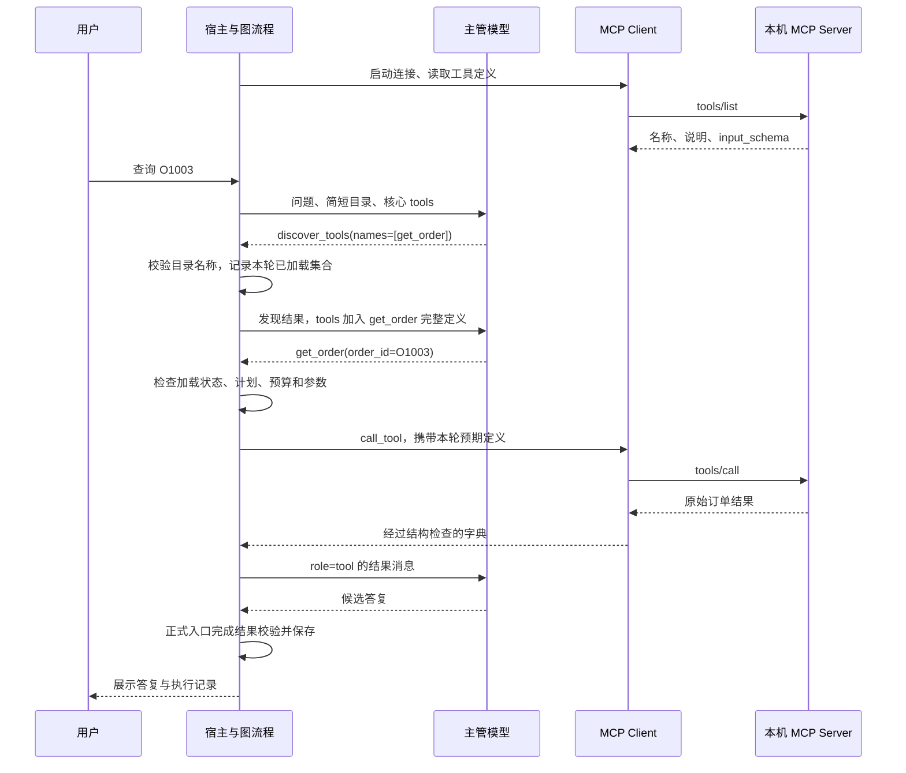

# 第十二课：MCP 接入与工具按需发现

> 本文按课程阶段讲解；请在仓库根目录执行命令。安装与当前功能以[仓库 README](../README.md)为准，早期章节中的简化流程不代表最终实现。

这份教程对应 `.` 当前实现。读完后，你应能沿代码解释一次订单查询：工具定义从哪里来、模型什么时候看到参数、谁执行 Python 函数，以及怎样用执行记录核对结果。

本项目固定使用官方 Python SDK `mcp==2.2.0`，服务端采用公开的低层 `Server` 回调接口，客户端采用 `Client` 与 stdio。不要把旧版 SDK 的示例直接混进当前代码。

## 1. 先分清三个角色、三件事

| 角色 | 本项目中的对象 | 负责什么 |
|---|---|---|
| Host，宿主应用 | FastAPI 网页应用和正式 LangGraph 流程 | 管理会话、模型请求、工具权限、预算、审批和结果 |
| MCP Client，协议客户端 | `LocalMCPClient` 包装官方 `Client` | 启动本机工具进程，读取定义，发送工具调用 |
| MCP Server，工具服务 | `mcp_tool_server.py` 子进程 | 声明两个只读工具，校验参数，执行已有业务函数 |

主管模型是宿主调用的语言模型，不是 MCP Client，也不是 MCP Server。MCP 服务不需要再部署一个聊天模型。

| 概念 | 本项目实际做的事 |
|---|---|
| 模型的 function calling | 模型根据当前 `tools`，返回工具名和 JSON 参数；Python 接收后决定是否执行 |
| MCP 协议 | 用 `tools/list` 取得服务端工具定义，用 `tools/call` 调用工具并取得结果 |
| 本项目的按需发现 | 模型先调用宿主的 `discover_tools`，宿主才把所选工具的完整定义放入下一次模型请求 |

MCP 的 `tools/list` 也可以称为“发现服务器工具”，但它与本项目的 `discover_tools` 不是同一个调用。前者发生在宿主与工具服务之间；后者是主管模型可调用的本地控制工具。

**选择工具仍由当前主管模型完成。** 这里没有额外的“工具选择模型”，没有根据问题自动搜索任意服务，也没有把工具选择交给 MCP 协议。

## 2. 当前到底接了哪些工具

| 工具名 | 执行位置 | 如何获得主管可调用的定义 |
|---|---|---|
| `get_order` | MCP 子进程，调用原来的 `orders.get_order` | 从 MCP 目录中按需加载 |
| `search_knowledge` | MCP 子进程，调用原来的 `KnowledgeBase.search` | 从 MCP 目录中按需加载 |
| `search_history` | 宿主应用，读取当前会话历史 | 从本地目录中按需加载 |
| `prepare_return_request`、`get_return_request` | 宿主应用，使用已有售后逻辑 | 从本地目录中按需加载 |
| `update_plan`、`delegate_tasks` | 宿主应用，规划与任务委派 | 启用相应能力时作为核心工具提供 |
| `discover_tools` | 宿主应用，更新本轮加载状态 | MCP 模式下初始提供 |

目录按当前入口实际启用的能力生成，不是固定把所有能力开放给所有入口。`get_order` 仍查询示例订单；`search_knowledge` 仍只读指定知识目录。

加载退货工具不会跳过审批。生成预览仍需人工批准，提交模拟申请仍需用户确认；MCP 服务没有退货、退款、改地址等写工具。

## 3. 从一条问题看完整流程

以“请查询 O1003 当前订单状态”为例，下面是典型路径；模型也可能按问题需要先制定计划。



“下一次请求加入定义”是关键。模型刚选择 `get_order` 时，发现结果只告诉它工具已经加载；完整参数由宿主通过下一次请求的 `tools` 字段提供。

若模型把 `discover_tools` 和 `get_order` 放在同一批输出中，宿主会拒绝混合批次。不能用“模型猜对参数了”代替读取定义和权限检查。

## 4. 服务端：把原有函数变成 MCP 能力

先看 [mcp_tool_server.py](../mcp_tool_server.py)。入口接受知识目录、检索方式与 Embedding 缓存目录，构造原有 `KnowledgeBase`。

两个回调是官方 SDK 低层 `Server` 的接入点。以下为实际代码节选：

```python
async def list_tools(context, params):
    return ListToolsResult(tools=definitions)

return Server("local-business-tools", version="1",
              on_list_tools=list_tools, on_call_tool=call_tool)
```

`definitions` 中的 `Tool` 包含名称、说明、`input_schema` 和只读提示。`input_schema` 是参数的 JSON Schema，例如 `get_order` 要求字符串 `order_id`，拒绝未声明的额外字段。

服务端不只发布说明，还用 `Draft202012Validator` 校验实际参数，再按固定分支选择已有函数：

```python
function = get_order if params.name == "get_order" else knowledge.search
result = await anyio.to_thread.run_sync(function, arguments[key])
return CallToolResult(
    structured_content=result,
    content=[TextContent(type="text", text=json.dumps(result, ensure_ascii=False))],
)
```

上面省略了先行的工具白名单和参数校验。`structured_content` 给 Python 读取原始字典，`content` 提供协议中的文本表示。业务逻辑仍在 [orders.py](../orders.py) 和 [knowledge_base.py](../knowledge_base.py)。

服务通过 `stdio_server()` 读写标准输入输出，因此不监听额外 HTTP 端口。stdout 用于协议消息，随意 `print()` 调试内容会破坏通信；需要日志时使用 stderr 或日志模块。

## 5. 客户端：真实协议连接与清理

[mcp_tool_client.py](../mcp_tool_client.py) 的公共用法如下。这段 Python 可用于理解接口，不需要模型 API key：

```python
import asyncio
from pathlib import Path
from mcp_tool_client import LocalMCPClient

async def main():
    client = LocalMCPClient(
        Path("../knowledge"),
        search_mode="keywords", timeout_seconds=6,
    )
    try:
        await client.start()
        definitions = await client.list_tools()
        order_schema = next(t for t in definitions
                            if t["function"]["name"] == "get_order")
        result = await client.call_tool(
            "get_order", {"order_id": "O1003"}, expected_schema=order_schema,
        )
        print(result)
    finally:
        await client.close()

asyncio.run(main())
```

客户端使用固定的当前 Python 解释器与本项目服务脚本，通过 `StdioServerParameters` 启动子进程。SDK 只继承允许的操作系统环境变量，不传入聊天 API key；Windows 子进程隐藏窗口。

官方 `Client` 必须进入异步上下文后才能使用。本项目由一个专门的任务执行 `async with Client(...)`，在同一任务内关闭连接；应用的不同请求通过队列访问它。

当前这条 MCP 连接**串行处理工具请求**。多个会话可以安全共享连接，但不能把宿主的并行调度统计理解为 MCP 服务内同时执行多个请求。若以后追求并发吞吐，需要另行设计和验证。

## 6. 宿主怎样把 MCP 定义交给模型

[api_app.py](../api_app.py) 在应用启动时创建并启动 `LocalMCPClient`，应用退出时调用 `close()`。正式聊天把客户端传给 [agent_service.py](../agent_service.py) 的 `stream_agent(..., mcp_client=None)`，再进入正式图流程。

[full_agent_graph.py](../full_agent_graph.py) 从 `await mcp_client.list_tools()` 得到真实定义，替换订单、知识工具的本地定义。它只接受已注册的两个 MCP 名称，缺少必需工具就报错。

每次执行创建自己的 `ToolDiscovery`。在每次主管模型请求之前，图都会刷新实际使用的工具列表：

```python
if selection is not None:
    tools = selection.request_tools()
    context.tools = tools
```

随后同一个 `tools` 被用于上下文预算，并传入模型 SDK 的 `chat.completions.create(..., tools=tools, ...)`。因此，加载工具改变的是下一次请求的真实工具列表，不是仅在提示词里声称它可用。

执行时，[agent_service.py](../agent_service.py) 的 `execute_mcp_tool` 把调用交给 `client.call_tool(..., expected_schema=expected_schema)`。连接错误继续交给运行时处理，工具业务错误转换成可读结果，定义变化则阻止旧执行继续。

## 7. `discover_tools` 具体做了什么

打开 [tool_discovery.py](../tool_discovery.py)。`instructions()` 从宿主已注册的工具生成简短目录；模型需要填写目录中的精确名称，例如：

```json
{"names": ["get_order", "search_knowledge"]}
```

`discover()` 校验这个 JSON，更新 `loaded` 集合。返回值类似下面的节选，完整参数定义不会再复制进发现结果：

```json
{
  "status": "loaded",
  "tools": [
    {"name": "get_order", "source": "mcp"},
    {"name": "search_knowledge", "source": "mcp"}
  ]
}
```

一次可选择 1 至 5 个名称；同次不能重复，名称不能越过目录。每个用户回合最多尝试 3 次发现，错误的发现参数也消耗次数。已加载集合只属于本次执行，新回合重新选择。

`permits()` 在执行前检查主管是否已加载该业务工具。发现操作不占业务工具额度，也不能充当计划完成证据；它受独立次数限制，并最多按发现次数补充 3 个主管请求名额，实际模型请求仍照常记账。

## 8. 子 Agent 与断点恢复

子任务的职责已经收窄，所以不要求每个子 Agent 再做一次发现。订单子 Agent 直接获得唯一的 `get_order` 定义，知识子 Agent 直接获得唯一的 `search_knowledge` 定义；其业务调用仍走 MCP。

主管通过 `delegate_tasks` 选择是否委派。[subagent_runtime.py](../subagent_runtime.py) 管理子任务消息、请求次数和交接；正式图负责提供职责工具和 MCP 调用回调。子 Agent 需要模型请求，它与工具服务子进程是两个不同概念。

[ToolDiscovery.snapshot()](../tool_discovery.py) 保存已加载工具及子任务工具的定义哈希、发现次数和事件。哈希是完整定义的摘要，用于比较定义有没有变化；不是工具执行结果，也不是授权凭据。

检查点不保存 SDK 客户端或子进程。恢复时重新读取 MCP 定义并核对哈希；连接重建也重新执行 `tools/list`。真正调用前，客户端再比较该执行传来的 `expected_schema`，防止别的会话刷新连接后让旧执行误用新定义。

已经保存的业务结果不会因为恢复而重放；尚未保存的只读工作可能需要重做。定义变化时会明确拦截，需要放弃旧执行后重新提问。缺少发现状态的旧检查点保留旧的完整定义和本地执行路径；新的 MCP 检查点需要在 MCP 模式恢复。

连接失败抛出 `MCPUnavailableError`，不会悄悄改为本地函数调用。客户端本身不自动重试同一次失败调用；后续调用可以重连，是否重试由现有 `ToolRuntime` 在总超时和尝试次数内决定。

## 9. 切换模式与启动

在 PowerShell 中进入项目。正式服务默认 `mcp`；下面显式指定模式便于学习。这些赋值只影响当前终端及其后续子进程，不修改真实 `.env`：

```powershell
# 在仓库根目录运行
$env:AGENT_TOOL_MODE = 'mcp'
$env:AGENT_HISTORY_SEARCH = 'hybrid'
.\.venv\Scripts\python.exe -X utf8 .\07_api_server.py
```

如果 [聊天页面](http://127.0.0.1:8000/) 已能打开，不必重复启动。要切换已有服务的模式，需先正常停止原服务，再从设置好变量的终端启动；修改终端变量不会改变已运行进程。

需要对照原本地直接调用时，将 `AGENT_TOOL_MODE` 改成 `local` 后启动。需要只用关键词检索时，将 `AGENT_HISTORY_SEARCH` 改成 `keywords`。恢复 MCP/hybrid 时把值改回即可。

`AGENT_HISTORY_SEARCH=hybrid` 同时影响历史和知识检索。MCP 知识服务沿用 [LocalEmbeddings](../local_embeddings.py)，从 `.local/embeddings` 读取本机模型；应用进程与 MCP 进程各自管理模型实例和内存缓存。

本机 Embedding 把文本转成向量，不是聊天模型 API。推理使用 `local_files_only=True`；模型缺失或不可用时，现有检索逻辑回退到关键词并报告状态。首次下载 Embedding 模型属于独立安装步骤，详见 [第十课](10_业务知识库RAG使用.md)。

## 10. 在网页上验证，而不是只看回答

新建测试对话，先尝试下面三个问题，分别观察直接调用、一次发现多个工具、任务委派：

> 请查询 O1003 当前订单状态。

> 请直接查询 O1003 当前状态，并查知识库说明示例退货期限，再汇总。

> 请让订单查询 Agent 查询 O1003 状态，让知识检索 Agent 查询示例退货期限，再汇总。

打开 [执行记录 `/runs`](http://127.0.0.1:8000/runs)，选择对应会话与执行，检查：

1. 主管初始工具列表是否以核心控制工具为主；是否出现所需的“工具按需加载”事件。
2. 发现事件的名称、来源、当次已加载集合是否正确；下一次主管请求是否携带选中的定义。
3. `get_order`、`search_knowledge` 的执行来源是否为 `mcp`；参数、状态和结果是否符合问题。
4. 子任务是否只获得自己的职责工具；最终结果校验、错误或恢复状态是否如实记录。
5. “模型上下文预算”中的工具名称和“工具定义”估算开销如何随请求变化。

`source=mcp` 表示工具执行来源；知识片段中的 `source` 形如 `kb:<文档ID>:<起始位置>`，用于定位原文。这两个“来源”字段用途不同。知识卡片还保存版本、标题、章节和摘录，方便核对依据。

[trace_store.py](../trace_store.py) 保存发现和执行事件；[context_observation.py](../context_observation.py) 记录预算与实际准备的工具列表。“准备就绪”不是服务商确认收到请求，更不表示业务函数已经成功执行。

## 11. 测试、离线对照与真实模型验收

以下命令可在项目目录自行运行。传输层测试使用真实 MCP 子进程和临时知识库，不调用聊天模型；完整 MCP 测试还覆盖图、API、预算、恢复和评测器：

```powershell
.\.venv\Scripts\python.exe -m unittest discover -s tests -p 'test_mcp_transport.py'
.\.venv\Scripts\python.exe -m unittest discover -s tests -p 'test_tool_discovery.py'
.\.venv\Scripts\python.exe -m unittest discover -s tests -p 'test_mcp*.py'
```

用 [mcp_eval.py](../mcp_eval.py) 比较相同任务的 local/MCP 两条路径：

```powershell
.\.venv\Scripts\python.exe -X utf8 .\mcp_eval.py --output .local/evals/mcp-learning-offline.json
```

默认使用真实本地 API 流程、临时 SQLite、临时政策文件和真实 MCP 进程；主管决策、子模型、结果校验及 provider usage 都是脚本模拟。它验证流程和已定义规则，不代表真实模型能力或全面语义准确率。

命令生成同名 JSON 与 HTML，记录各场景结果、实际业务证据、请求、工具定义估算量、已报告 tokens 和耗时。恢复场景明确注入模型连接故障，检查结果是否复用；规则失败会保留失败结果，退出码为 1。

读报告时同时看证据和失败规则。例如一次知识调用先被计划约束拒绝，后来查询成功，最终可能拿到了正确资料，却仍触发“同轮重复检索”规则。取得业务结果与全部流程规则通过是两个判断，不能只选其中一个描述验收结果。

只有需要真实模型验收时才加 `--live`，例如只运行订单场景，并使用独立文件名保留离线报告：

```powershell
.\.venv\Scripts\python.exe -X utf8 .\mcp_eval.py --live --case order_query --timeout 90 --output .local/evals/mcp-learning-live.json
```

`--live` 通过已有应用配置调用模型 API，会产生用量；临时业务数据不写入正常会话库。两种评测都固定关键词检索以控制变量，不能单凭这份对照报告证明 hybrid 检索效果。

## 12. 成本、限制与下一步阅读

MCP 的 `tools/list`、`tools/call` 和本机 Embedding 推理本身不会调用语言模型 API。主管决策、子 Agent、历史摘要、结果校验会调用配置的模型；知识片段进入模型上下文后，也会占输入 tokens。

按需加载减少的是某些请求携带的完整工具定义。简短目录仍在上下文中，发现通常增加一轮主管请求，后续消息也有额外内容。只有两个 MCP 工具时，总 tokens 和耗时可能增加，不能把单次定义变小等同于总成本降低。

工具定义 tokens 使用项目原有 UTF-8 保守估算，与上下文预算算法一致；服务商报告的 usage 是另一项数据。没有报告的用量不是零，没有配置价格也不能据此算出零费用。

当前实现只连接一个固定的本机服务、只允许两个 MCP 工具，不提供任意命令或远程 MCP 地址配置。以后接新服务需要修改连接配置、工具白名单、图适配与测试；新增写工具还需设计审批和重复调用处理，不能只在目录里加一行名称。

推荐沿这些文件继续阅读：先看 [服务端](../mcp_tool_server.py) 与 [客户端](../mcp_tool_client.py)，再看 [按需发现状态](../tool_discovery.py)、[正式图](../full_agent_graph.py) 和 [评测入口](../mcp_eval.py)。

官方资料：[Python SDK](https://github.com/modelcontextprotocol/python-sdk)、[Client 生命周期与工具调用](https://py.sdk.modelcontextprotocol.io/client/)、[stdio 传输与环境继承](https://py.sdk.modelcontextprotocol.io/client/transports/)、[工具参数与返回值](https://py.sdk.modelcontextprotocol.io/servers/tools/)。官方示例常用高层 `MCPServer`；本项目选择同一 SDK 的低层 `Server`，以显式维护和校验发布的参数定义。
