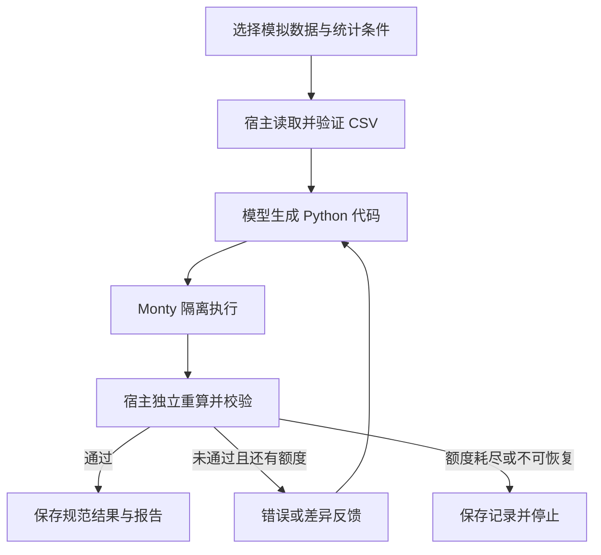

# 第十四课：代码执行 Agent 与沙箱隔离

> 本文按课程阶段讲解；请在仓库根目录执行命令。安装与当前功能以[仓库 README](../README.md)为准，早期章节中的简化流程不代表最终实现。

这一课已经接入项目。打开 [数据分析实验](http://127.0.0.1:8000/code)，可以观察模型生成 Python、执行代码、接收错误反馈、修正代码以及交付报告的完整过程。聊天首页也增加了“数据分析实验”入口。

本课使用两份模拟订单 CSV，使用自行配置的 DeepSeek，无需新的模型账号、GPU 或 Docker。代码在本机 Monty 专用解释器的独立工作进程中运行，支持 Python 的一个子集。

## 1. 先动手运行一次

在实验页面选择：

1. 使用的数据：模拟订单。
2. 按什么分组：商品。
3. 退款率关注阈值：30%。
4. 运行方式：正常分析。
5. 点击“开始分析”。

页面会显示每轮生成的代码、执行结果和校验反馈。只有通过独立校验，才会出现统计表、“下载分析报告”和“下载统计表”。

预期结果如下，显示顺序不影响正确性：

| 商品 | 订单数 | 退款数 | 退款率 | 达到 30% |
| --- | ---: | ---: | ---: | --- |
| 无线耳机 | 6 | 2 | 33.33% | 是 |
| 机械键盘 | 6 | 1 | 16.67% | 否 |
| 无线鼠标 | 6 | 3 | 50.00% | 是 |

这里的统计口径是 **已退款订单数 ÷ 全部订单数**，包含已取消订单。每行是一个订单，只有 `status == "refunded"` 才计入退款数。这是练习中明确约定的口径；达到阈值仅表示需要进一步核查，不能据此判断退款原因。

“边界样例”包含取消订单、零退款和全退款分组。切换为按渠道统计，可以观察模型如何根据 `group_by` 生成通用计算代码。

## 2. 观察 Agent 根据反馈改变行动

再次运行时选择“练习修复运行错误”。首次实际执行代码时，系统会明确注入一个 `ValueError`。执行器返回真实错误，模型在下一轮重新生成代码。展开记录，可以分别查看模型原本生成的代码和本轮实际执行的练习代码。

再选择“练习纠正计算结果”。首次执行返回空分组和错误的总数。这段代码可以正常运行，但独立校验不通过；校验反馈会进入下一次模型请求，要求重新计算。

这两种错误是教学用的受控注入，页面会标注，不能把它们描述为模型自然发生的错误。正常模式不会主动注入。若第一次模型响应不是合法代码，注入会等待首次实际执行，不会被跳过。

每个任务最多生成三次代码，格式错误也消耗一次机会。不是保证成功重试三次：初次生成占一次，剩余最多两次修正。超过次数仍不正确时保存失败记录，不交付报告。模型服务故障或上下文预算不足会提前停止。

## 3. 这为什么属于 Agent 开发

过去的订单 Agent 从预先写好的函数中选择工具，例如查询订单和检索政策。本课进一步让模型为一个受约束的计算任务生成程序，由运行环境执行，再把实际反馈交回模型。



模型负责生成什么代码、收到错误后如何修改。LangGraph 负责节点流转和有界循环；沙箱负责限制代码能力；校验器负责判断结果是否正确。恢复循环并不会训练模型或修改模型权重，每次修正仍是一次携带反馈的新请求。

当前任务由页面的结构化选项确定，没有开放任意自然语言编程、文件上传或正式业务工具调用。先用可验证的任务学习这套机制，再扩大任务范围。

## 4. 从哪些关键代码开始看

项目目录为 `.`。

| 文件 | 主要职责 |
| --- | --- |
| [code_agent.py](../code_agent.py) | 模型请求、三节点图、反馈与修正上限 |
| [code_sandbox.py](../code_sandbox.py) | Monty 工作进程、能力限制、执行结果与错误 |
| [code_data.py](../code_data.py) | CSV 校验、独立重算、报告生成 |
| [code_experiments.py](../code_experiments.py) | 后台任务、记录持久化、取消和下载接口 |
| [code_eval.py](../code_eval.py) | 离线工程验收和真实模型评测 |
| [code.js](../web/code.js) | 页面轮询、代码和反馈展示、报告下载 |

建议按照 `ModelCodeGenerator.__call__` → `run_analysis` → `run_code` → `verify_report` 的顺序阅读。

### 模型看见什么

`run_analysis()` 构造的任务包含字段定义、分组字段、行数、前三行样例和数据指纹。完整订单数据不会全部塞入模型输入。它由宿主读取，作为普通 `rows` 数据传给沙箱。

模型收到的数据大致如下：

```json
{
  "task": "统计各分组的订单数、退款数与退款率。",
  "group_by": "product",
  "fields": ["order_id", "product", "channel", "status"],
  "row_count": 18,
  "sample_rows": ["实际请求中这里是前三条订单对象"],
  "source_sha256": "当前样例文件的 SHA-256"
}
```

这是结构示意，真实请求的 `sample_rows` 是订单对象。样例、执行反馈及后续代码会发送给已配置的模型服务；“本地执行”不代表“模型请求离线”。

模型必须返回一个 JSON 对象，包含 `code` 和可选的简短 `note`。代码最后一个表达式返回报告字典，不负责写文件。例如它可能生成：

```python
groups = {}
for row in rows:
    name = row[group_by]
    if name not in groups:
        groups[name] = {
            "name": name, "orders": 0,
            "refunded": 0, "refund_rate": 0.0
        }
    groups[name]["orders"] += 1
    if row["status"] == "refunded":
        groups[name]["refunded"] += 1

for group in groups.values():
    group["refund_rate"] = group["refunded"] / group["orders"]

{"groups": list(groups.values()), "total_orders": len(rows)}
```

真实模式不会把这份参考答案发给模型。`examples/code-agent/reference.py` 仅供离线评测使用。

### 模型请求与 token 预算

关键调用位于 `ModelCodeGenerator`：

```python
response = await self.client.with_options(
    timeout=30.0, max_retries=0
).chat.completions.create(
    model=self.model,
    messages=messages,
    response_format={"type": "json_object"},
    max_tokens=1800,
    stream=False,
    extra_body={"thinking": {"type": "disabled"}},
)
```

这个简短计算任务明确使用非思考模式。开发中的复测发现，默认思考模式会耗尽小输出额度，导致最终代码 JSON 截断。DeepSeek 的当前思考开关与默认行为见 [官方说明](https://api-docs.deepseek.com/guides/thinking_mode/)。此配置仅作用于本实验的代码生成请求。

输入仍受 `AGENT_CONTEXT_TOKENS` 约束：估算输入，加上 1800 个输出 tokens 和安全预留，不能超过总预算。恢复时只携带上一份候选代码和失败反馈，完整轨迹留在任务记录中。这种有界短任务暂不需要再生成滚动摘要。

## 5. 沙箱具体是怎样接入的

依赖已经固定为 `pydantic-monty==0.0.23`。新环境安装项目依赖即可：

```powershell
# 在仓库根目录运行
.\.venv\Scripts\python.exe -m pip install -r requirements.txt
```

`run_code()` 的核心代码是：

```python
from pydantic_monty import AsyncMonty

async with AsyncMonty(
    binary_path=status["binary"],
    min_processes=1,
    max_processes=1,
    checkout_timeout=3,
    request_timeout=policy.seconds + 3,
    max_checkouts_per_worker=1,
) as pool:
    async with pool.checkout(
        script_name="analysis.py",
        print_flush_interval=0,
        limits={
            "max_duration_secs": policy.seconds,
            "max_memory": policy.memory_bytes,
            "max_recursion_depth": 100,
            "max_suspensions": 32,
        },
    ) as session:
        value = await session.feed_run(
            code,
            inputs={"rows": rows, "group_by": group_by},
            external_lookup={},
            print_callback=capture,
        )
```

以上省略了结果大小检查、异常转换等外围代码，完整实现见 `code_sandbox.py`。`status["binary"]` 指向当前虚拟环境内的固定 worker，不接受页面提供的可执行文件路径。

这里有三个关键点：

- 输入只有普通数据，没有传入宿主函数、带权限的 Python 对象、挂载文件或系统调用处理器。生成代码没有读取 `.env`、访问聊天数据库、联网或启动系统进程的能力。
- 使用专用解释器和独立工作进程执行。普通 Python `exec`、删几个内置函数或用关键字黑名单，都不能替代这层隔离。
- 沙箱不可用时明确停止，不偷偷回退到宿主 Python。每次代码执行使用新会话，不继承上一次变量或权限。

Monty 是 Python 子集的语言级沙箱，本课没有创建 Docker 容器，也不支持任意 `pip install`、pandas 或系统命令。独立进程与完整操作系统沙箱不是同一个层次。该依赖仍较早期，本实现用于本机模拟数据实验，没有完成面向公网多租户恶意代码服务的安全认证。能力模型可参阅 [Monty 安全说明](https://pydantic.dev/docs/monty/concepts/security/)，调用方式见 [Python 快速入门](https://pydantic.dev/docs/monty/quickstart/python/)。

本课的限制集中在 `SandboxPolicy` 和模型请求适配器：

| 项目 | 当前限制 |
| --- | --- |
| 模型生成 | 每任务最多 3 次；每次超时 30 秒；输出 1800 tokens |
| 单次代码执行 | 解释器执行时间上限 2 秒；另有 worker 请求超时保护 |
| 内存 | 32 MiB 的受控解释器分配，不是整个进程 RSS 上限 |
| 生成代码 | 最多 12000 字符 |
| 打印输出 | 标准输出与错误输出合计最多 4096 字符，超限停止 |
| 返回数据 | 只接受可转为有限 JSON 的结果；序列化后最多 64 KiB |
| 输入 | CSV 最多 128 KiB、1000 行；传入沙箱的 JSON 另限 128 KiB |
| 并发 | 当前单进程服务最多运行一个分析任务，无无限队列 |

结果的 64 KiB 检查发生在 worker 返回之后；执行期间仍依靠解释器内存限制控制分配。资源限制的含义见 [Monty 资源限制文档](https://pydantic.dev/docs/monty/concepts/resource-limits/)。

## 6. 代码没报错，为什么还要校验

以下代码能运行，但结论错误：

```python
{"groups": [], "total_orders": 0}
```

更隐蔽的错误是把取消订单排除分母、漏掉零退款商品、重复分组或把退款率返回成百分数 `33.33`。所以本课的 `verify_report()` 不会相信代码自行声明“成功”，而是在宿主侧重新计算。

它先验证结构和数值类型，再调用 `reference_report()` 使用原始数据计算各组总数、退款数和退款率，然后逐项比较。整数不能用布尔值冒充，NaN、遗漏分组、额外字段均不会通过。

候选退款率允许 `1e-6` 的舍入误差；但最终报告使用宿主重算的精确值，防止 `0.333333` 与真实 `1/3` 在临界阈值上给出不同结论。候选原始值仍保留在执行记录中。

校验成功后，`render_reports()` 用可信模板生成固定的 `report.md` 和 `report.csv`。模型不能提供任意文件名或 HTML。只有状态完成、校验通过的任务才能下载报告。

本课的独立校验针对这个明确的统计任务，可以精确重算。将来开放任意数据分析时，需要为任务定义可核验的约束、参考计算或人工审查；不能认为同一个校验器可以判断所有程序的正确性。

## 7. 记录、取消与重启

正式入口的实验记录单独保存在：

```text
.\.local\code-agent\<任务 UUID>\
    input.csv
    run.json
    report.md     # 仅完成并校验通过后生成
    report.csv    # 仅完成并校验通过后生成
```

`run.json` 保存代码、错误、校验、用量和事件。页面关闭后后台仍继续运行，再次进入页面可以选择已有记录。停止任务会取消正在等待的模型或执行操作，并释放当前运行名额；已经发生的模型请求仍可能产生用量，中途取消时用量也可能尚未回报。

Windows 临时拒绝替换记录文件时，服务最多尝试 5 次写入，在重试间异步等待，合计等待不超过 0.5 秒。若终态记录持续无法写入，页面会明确显示失败并释放任务名额，报告不可下载；这时失败状态只能保留在当前进程内，不能声称已经持久化。

本版本没有给代码沙箱接入跨进程检查点。服务重启后，未完成的分析会标记“执行已中断”，需要新建实验；已有完成报告仍可查看。聊天系统原有的 LangGraph 检查点与审批流程继续按原方式工作。

## 8. 自动验证

离线评测使用固定脚本模型，但沙箱是真实运行的，不会向聊天模型发请求：

```powershell
.\.venv\Scripts\python.exe -X utf8 code_eval.py
```

真实模型评测会产生调用用量，沿用已有 `.env` 配置：

```powershell
.\.venv\Scripts\python.exe -X utf8 code_eval.py --live --repeats 2
```

新模块回归测试包括真实隔离、超时、内存、输出上限、取消、失败停止、错误修复、阈值边界、记录和下载：

```powershell
.\.venv\Scripts\python.exe -X utf8 -m unittest discover -s tests -p 'test_code*.py'
```

每次运行会生成自己的评测报告，包含案例结果、模型请求数、已报告 token 用量和耗时。真实模型报告来自当前配置与固定样本，不能代表任意任务的成功率；本仓库不附带个人运行记录。

## 9. 常见问题

**模型会不会看到全部订单？**

不会在初次请求中收到完整 CSV，只有字段、行数与前三行样例。执行器拿到完整普通数据。后续反馈与生成的代码也会进入模型请求，因此这是一种减少模型输入量的设计，不是对任意敏感数据的防泄漏证明。本课只使用模拟数据。

**为什么不直接给它一个执行 Python 的工具？**

可以对 Agent 暴露代码执行工具，但工具背后仍必须有执行环境、能力范围、资源预算和结果检查。本课先把这些基础机制做成独立实验，没有给正式客服开放任意代码权限。

**与 MCP、Skills 有什么关系？**

MCP 可以提供数据或操作能力；Skills 可以提供任务步骤和编码约定；代码执行环境负责运行生成的程序。将来若要从代码调用 MCP，应由宿主逐项提供受约束的函数入口并继续校验权限，不能把 API Key 或通用系统执行能力直接交给沙箱。本课没有做这层桥接。相关架构讨论见 [Anthropic 的代码执行与 MCP 文章](https://www.anthropic.com/engineering/code-execution-with-mcp)。

**页面说运行环境未就绪怎么办？**

确认使用项目的 `.venv`，安装固定版本 `requirements.txt` 后重启服务。配置接口 `/api/code/config` 会返回可读原因。不要为了运行成功而将 `run_code()` 替换为 `exec`。

**下一步怎样扩展？**

先增加一个仍能独立校验的统计目标，例如按渠道与商品交叉分组：同步修改任务输入、报告结构、独立重算和测试，再观察模型能否根据新约束生成正确程序。需要 pandas 或任意 Python 依赖时，再设计容器执行后端、挂载范围、联网策略、用户隔离和产物审核，不能只放开 `import`。
